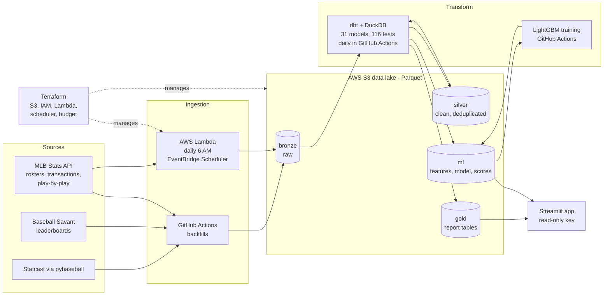

# Baseball Advance Scouting Report Generator

> Advance reports in seconds, not hours — automated, cloud-hosted, and built for a coach to read.


Before every series, an MLB advance-scouting group turns pitch-tracking data into reports on opposing pitchers and
hitters: what they throw, when, where, and how to attack them. It also has to track who is actually on the roster,
day by day. Much of that work is repetitive data preparation under time pressure, and the output has to be readable
by coaches, not just analysts. This project automates the whole chain: data lands in a cloud data lake every day,
gets cleaned and tested, feeds a calibrated whiff model, and ends in an app where a coach picks an opponent and gets
a plain-language **"how to attack him"** plan for every player.

**Data note:** built on real, public data: Statcast pitch-level data from Baseball Savant (via pybaseball), the MLB
Stats API (rosters, transactions, play-by-play) and Baseball Savant leaderboards. Full 2026 regular season. Personal,
non-commercial portfolio project; data used under the sources' public terms.

**[Live App](https://baseball-advance-scouting.streamlit.app)** · **[Code](https://github.com/Hari-Etta/Portfolio/tree/main/05-baseball-scouting-reports)** · **[Portfolio](https://github.com/Hari-Etta/Portfolio)**
*(the app may take a moment to wake up on first visit)*

---

## Table of Contents
- [At a Glance](#at-a-glance)
- [Status](#status)
- [What Makes It Different](#what-makes-it-different)
- [Architecture](#architecture)
- [The App](#the-app)
- [Data & Quality](#data--quality)
- [Transformations (dbt on S3)](#transformations-dbt-on-s3)
- [Whiff Model](#whiff-model)
- [Running Game & Defense](#running-game--defense)
- [Automation & Infrastructure](#automation--infrastructure)
- [Validation Beyond Tests](#validation-beyond-tests)
- [Findings](#findings)
- [What Testing Found (and Fixed)](#what-testing-found-and-fixed)
- [Known Limitations](#known-limitations)
- [Project Structure](#project-structure)
- [Running This Yourself](#running-this-yourself)
- [Accounts Used](#accounts-used-all-free-tier)
- [Operational Notes](#operational-notes)
- [License](#license)

---

## At a Glance
- **Data:** 716,792 Statcast pitches (2,429 games), MLB Stats API rosters, transactions and play-by-play
  (14,392 running-game events), and Baseball Savant leaderboards.
- **Runs itself:** an AWS Lambda pulls rosters and transactions every morning; GitHub Actions rebuilds and tests every
  table daily.
- **Tested:** 31 dbt models and 116 data tests, including leakage guards and cross-table reconciliations.
- **Model:** LightGBM whiff probability, 22% better than a constant baseline in every walk-forward test month,
  AUC 0.80, calibrated within about 1 point.
- **Infrastructure as code:** Terraform with remote state; least-privilege IAM; the public app is read-only.
- **Honest by design:** rule-based summaries show their sample sizes; our own tests found clutch hitting and
  "whiffs over expected" weren't repeatable, and the app says so.

---

## Status

| Phase | Description | Status |
|---|---|---|
| 1 | AWS setup, ingestion (Statcast + MLB Stats API → S3), data-quality report | ✅ Done |
| 2 | dbt silver/gold models on S3, tests passing | ✅ Done |
| — | Scouting additions: home/road, attack zones, command, swing decisions, bat tracking, spray charts, run expectancy, situational hitting | ✅ Done |
| 3 | Whiff model: leakage-guarded features, walk-forward evaluation, calibration, cloud training | ✅ Done |
| 4 | Terraform, daily Lambda + EventBridge pull, scheduled dbt, running game & defense data | ✅ Done |
| 5 | Streamlit app live | ✅ Done — [live](https://baseball-advance-scouting.streamlit.app) |
| 6 | README, résumé bullet, interview pitch, outreach | 🔧 In progress |

Ideas deliberately deferred, with reasons, are tracked in [BACKLOG.md](BACKLOG.md).

---

## What Makes It Different
1. **It runs itself.** Scheduled ingestion, tested transformations and a live app, not a one-off notebook.
2. **Every report ends in a recommendation.** Rule-based "how to attack him" summaries: deterministic, every sentence
   traceable to a number with its sample size, no invented claims.
3. **The model is calibrated, not just accurate.** A coach needs "40% whiff chance" to mean 40%. Leakage is guarded
   by as-of joins and dbt tests that fail the build.
4. **Data QA is visible.** Game counts reconciled to the official schedule, hitter and pitcher tables reconciled to
   the plate appearance, and every surprising number traced to its cause.
5. **It tests its own ideas.** Hot streaks, clutch hitting and "whiffs over expected" were each backtested; the
   results (half real, not real, not repeatable) are reported, even when they undercut the original idea.

---

## Architecture



**Tech stack:** Python · SQL · dbt Core + DuckDB · AWS (S3, Lambda, EventBridge Scheduler, IAM, CloudWatch) ·
Terraform · GitHub Actions · LightGBM + scikit-learn · Streamlit + Plotly

---

## The App

**Live:** https://baseball-advance-scouting.streamlit.app · Streamlit Community Cloud · reads gold tables and the
model from S3 with a read-only key, behind a `DATA_BACKEND` setting (so it can switch to MotherDuck later).

| Page | What a coach gets |
|---|---|
| Home | Pick the opponent; its pitchers and hitters with **current roster status** (daily snapshot: active, IL, left in free agency); "What changed" roster moves |
| Pitcher report | **How to attack him** summary; arsenal with command and movement; movement chart; usage by count; location heatmap; platoon; form and velocity flag; home/road; spray allowed (12 field zones) for positioning |
| Hitter report | **How to attack him** summary; splits; results vs each pitch type; zone map; swing decisions; bat tracking; spray chart by pitcher hand, pitch group and speed; runners on base (with clutch caveat); form; home/road |
| Running game & defense | Runners (attempt rate, sprint speed), pitchers' hold (pickoff throws per opportunity), catchers (pop time chart), fielders (OAA by direction, outfielder jump) |
| Pitch planner | The whiff model scores one of our pitches against their hitter across 121 locations; "whiff if he swings" and "whiff per pitch" views |
| Methods & data | Freshness, sources, definitions, every summary threshold, validations, limitations |

**Honesty features:** rule-based summaries with sample sizes; small samples flagged (⚠️); thin heatmap cells hidden;
a global toggle for counting reached-on-error as hits (Statcast's wOBA convention, for checking against Savant).

---

## Data & Quality
Full 2026 regular season (Mar 25 – Sep 27, 184 game days): 716,792 pitches, 2,429 games, 868 pitchers, plus MLB Stats
API teams, daily 40-man roster snapshots, transactions and official profiles for all 1,470 players. Loaded into an AWS
S3 data lake (Parquet, bronze layer) under a least-privilege IAM user and a budget alarm. The full-season backfill runs
in about a minute and resumes safely after failures.

Quality findings:
- **Game count reconciled against the official MLB schedule:** 2,430 scheduled, 2,429 played, all 2,429 present.
  The one gap (BAL at NYY, Sep 27) was cancelled and never played.
- **0 duplicate pitch keys** in bronze; a dbt uniqueness test now guards against duplicate ingestion.
- **2,676 untracked pitches (0.37%): 2,309 are pitch-clock violations** (automatic balls/strikes, where no pitch is
  thrown); the other 367 are real pitches the tracking system missed. All kept and flagged, never deleted.
- **957 pitches under 50 or over 106 mph: 953 (99.6%) were thrown by position players** (56 position players,
  2,167 pitches). The first hypothesis (eephus pitches, knuckleballs) was wrong; the data ruled it out.
- **Transactions:** 1,007 duplicate rows from overlapping pulls removed.
- **Newer Statcast fields are well populated:** bat speed on 97.4% of swings, batted-ball location on 99.9% of balls
  in play, run value on 99.7% of pitches, arm angle on 99.6% of thrown pitches.
- **Shared names:** 2 names belong to two different players each (Max Muncy, 3B for LAD and ATH; Yunior Marte,
  P for CIN and SF). Display names add position and team; a unique test enforces it.
- **40-man rosters listing up to 51 players** are explained by 60-day injured players, who appear on the list but
  don't count against the limit in season.

---

## Transformations (dbt on S3)
dbt Core 1.12 + dbt-duckdb reads bronze Parquet from S3 and writes silver and gold Parquet back to S3.
**31 models, 116 data tests, all passing**; the daily rebuild runs in about 2 minutes in GitHub Actions.

**Silver:** `silver_pitches` (716,792 deduplicated, typed pitches; matches bronze exactly), `silver_players`,
`silver_running_game`.

**Shared base:** `int_pitches` defines every rule once (swing, whiff, plate appearance, wOBA contributions, chase,
hard-hit, HBP, teams and park, attack zones, pitch groups); `int_batted_balls` adds spray geometry and field zones.

**Gold (what the app reads):**
| Table | What a coach gets |
|---|---|
| `gold_players` / `gold_teams` / `gold_current_roster` | Player directory with unique display names; teams; current 40-man status and latest move |
| `gold_pitcher_arsenal` | Pitch mix, velocity, movement, arm angle, whiff / chase / CSW, command (heart / edge / chase / waste %) |
| `gold_pitcher_usage_by_count` | What he throws in every count, vs LHH and RHH |
| `gold_pitcher_locations` | Where each pitch goes (Statcast zones) and what happens there |
| `gold_pitcher_platoon` | Results vs LHH and RHH: K%, BB%, HBP%, wOBA, xwOBA, chase, hard-hit |
| `gold_pitcher_spray_allowed` | Where hitters put the ball against him (12 field zones), for defensive positioning |
| `gold_pitcher_whiff_over_expected` | Actual vs model-expected whiffs per pitch type ("likely to cool" flag) |
| `gold_hitter_splits` / `gold_hitter_vs_pitch_type` | Each hitter vs LHP/RHP and vs each pitch type |
| `gold_hitter_zones` / `gold_hitter_swing_decisions` | Where he swings, misses and does damage; swing/take run value by attack zone |
| `gold_hitter_bat_tracking` / `gold_hitter_spray` | Bat speed, swing length, attack angle; spray by pitcher hand, pitch group and speed |
| `gold_hitter_situational` | Results with runners on each base, vs his own overall level |
| `gold_player_home_road` | Home vs road results (park effects, e.g. Coors Field) |
| `gold_hitter_form` / `gold_pitcher_form` | Last 30 days vs earlier in the season; fastball velocity-drop flag; `as_of_date` backtesting |
| `gold_runner_running_game` / `gold_pitcher_running_game` / `gold_catcher_defense` / `gold_fielder_defense` | Running game and defense |
| `gold_run_expectancy` | Chance of scoring after each event, by runners on base and outs |
| `gold_transactions` | Deduplicated roster moves for the "what changed" feed |

**Design decisions:**
- **Keep and flag, never delete.** Position-player pitches and pitch-clock violations stay with flags; reports
  exclude them by default because they would mislead a coach.
- **Two wOBA conventions.** Default counts reached-on-error as an out (the fielder should have made the play); a
  Statcast-style column matches Baseball Savant. League 2026: .316 (errors as outs), .323 (Statcast), xwOBA .314.
- **Attack zones** (our implementation of Savant's heart / shadow / chase / waste): bands at 67% / 133% / 200% of each
  batter's own zone.
- **12 field zones:** infield/outfield × front/back × left/center/right (cutoffs 100 / 160 / 275 ft, ±15°).
- **Counts, not percentages, at fine grain** (spray charts), so the app never shows a misleading share from a tiny cell.

---

## Whiff Model
**Question:** if a hitter swings at this pitch, what is the chance he misses? (whiff per swing; base rate 22.9%)

**Data:** 339,601 swings, built as a tested dbt model (`ml_whiff_features`).

**Features, all known before the pitch:** pitch type, velocity, spin, arm angle, movement (arm-side and vertical,
flipped so lefties and righties compare); location relative to each batter's own zone; contrast with the pitcher's own
fastball; count and handedness; batter and pitcher whiff tendencies.

**Leakage prevention:**
- No after-the-pitch inputs (bat speed, exit velocity, launch angle, outcome, run value).
- Tendencies come from strictly earlier game dates (as-of joins); two dbt tests fail the build if any feature sees
  same-day or same-game data.
- Time-based splits only, never random.

**Results:**
| Evaluation | Log-loss | Baseline (always 22.9%) | Improvement | AUC |
|---|---|---|---|---|
| Rolling: test June | 0.419 | 0.539 | 22% | 0.80 |
| Rolling: test July | 0.421 | 0.539 | 22% | 0.80 |
| Rolling: test August | 0.413 | 0.533 | 23% | 0.80 |
| Rolling: test September | 0.418 | 0.539 | 22% | 0.80 |
| Cross-fitted, full season | 0.418 | 0.537 | 22% | — |

- **Calibrated:** on unseen September, every predicted-probability bin is within about 1.3 points of the actual whiff
  rate (e.g. predicted 29.3% → actual 29.6%). Cross-fitted calibration error 0.003 across the season.
- **What drives it:** location (about 58% of importance), then batter tendencies, count, pitch movement, and speed
  difference from the pitcher's fastball (whiff rate nearly doubles from within 2 mph to 6–10 mph slower).

**Experiments and decisions:**
- **Fatigue and recent-form features:** consistently lower log-loss but only by 0.0003. Not adopted: velocity and
  location already carry the fatigue signal, and three of these are only known during a game, while reports are pre-game.
- **Whiffs over expected:** well calibrated league-wide (77,815 actual vs 77,981 expected) but not repeatable
  (first-half vs second-half correlation 0.01), because the model already knows each pitcher's track record. Used as
  a "likely to cool" flag, not a skill measure.

**Production:** final model trained on the full season and saved to S3 with a model card (features, exact category
lists, training dates, evaluation). GitHub Actions retrains end to end in about 6 minutes. Runs are reproducible on the
same platform (sorted rows, fixed seed); Windows and Linux differ slightly in where early stopping lands (734 vs 802
trees) with the same quality.

---

## Running Game & Defense
- **Play-by-play feed (MLB Stats API):** 14,392 running-game events from all 184 game dates: 9,680 pickoff throws,
  3,289 stolen bases, 1,015 caught stealing (incl. pickoff caught stealing), 222 pickoffs, 186 pickoff errors.
  99.4% join to a Statcast at-bat with the same pitcher; the rest are outs on the bases before any pitch.
- **Baseball Savant leaderboards:** sprint speed, catcher pop time, Outs Above Average (by direction and batter hand),
  outfield catch probability, outfielder jump.
- **Validation:** runner, pitcher and catcher steal totals reconcile; faster runners attempt more (correlation +0.62)
  but don't succeed more (+0.06, likely selection); quicker catcher pop times mean more runners caught (−0.58);
  outfielder jump tracks OAA (+0.79).
- **Not available publicly:** pitcher step-offs without a throw, lead distances, steal timing.

---

## Automation & Infrastructure
**Runs itself every day:**
- **6:00 AM Denver:** EventBridge Scheduler triggers a Lambda (Python 3.13, official AWS SDK for pandas layer, pinned
  via SSM) that pulls 40-man rosters (dated snapshot) and recent transactions into S3 bronze, in about 3 seconds.
- **About an hour later:** GitHub Actions rebuilds silver and gold and runs every dbt test; GitHub emails on failure.
- **On demand:** GitHub Actions workflows for the Statcast backfill, play-by-play backfill and model training.

**Infrastructure as code (Terraform):** remote state in a dedicated, versioned, private S3 bucket with native state
locking; hand-made Phase 1 resources (data bucket, pipeline user, budget alarm) imported with no drift; the data bucket
has `prevent_destroy`; Lambda, scheduler, IAM roles and 14-day log retention defined in code.

**Least-privilege identities:**
| Identity | Can do | Where its keys live |
|---|---|---|
| `scouting-pipeline` | Read/write the data bucket only | `.env` (local) and GitHub Secrets |
| `scouting-app-readonly` | Read gold tables and the model only | Streamlit secrets |
| Lambda role | Write `bronze/mlb/*` and its own logs only | None (AWS role) |
| Scheduler role | Invoke the one Lambda only | None (AWS role) |
| `terraform-deployer` | Deploy infrastructure | Local AWS CLI profile only, never in the repo or CI |

The read-only user was verified with real requests (reads gold; denied on bronze and on writes), because the IAM policy
simulator reported organization-level denies that don't apply on this free-plan account.

---

## Validation Beyond Tests
- **Reconciliation:** hitter and pitcher tables match exactly: 181,220 plate appearances, 711,956 located pitches,
  122,568 batted balls, HBP rate 1.16%.
- **Physics and known players:** pitch movement matches pitch types; arm-angle extremes are known submarine and sidearm
  pitchers (Tyler Rogers, −60.6°); fastest bats are known power hitters (league 71.3 mph, 25.2% of swings 75+ mph).
- **Spray coordinates:** fielder positions land on the correct side (3B −37°, CF 0°, 1B +45°); home-run distances
  match Statcast within about 1%; pull rates mirror for left- and right-handed hitters.
- **Attack zones vs Statcast:** heart pitches are 100% inside Statcast's strike zone; chase and waste are 0%. Swing rate
  falls from 71.7% (heart) to 7.6% (waste); whiff rate on swings rises from 11.1% to 87.4%.
- **Swing decisions:** swinging beats taking only in the heart (+0.37 vs −6.18 runs per 100 pitches); taking wins in
  chase and waste. Run-value sign verified first (HR +1.53, ball +0.05, called strike −0.05).
- **Run expectancy:** chance of scoring rises with runners and falls with outs (bases empty, 0 outs: 27.0%; loaded,
  0 outs: 86.7%), with consistent transitions.
- **Park effects:** Colorado ranks #2 of 30 ballparks by league wOBA (.352), behind the Athletics' temporary park.

---

## Findings
- **Hot streaks are partly real:** in a backtest from Aug 28, hot hitters went from +.061 xwOBA above baseline to +.026
  over the next 30 days; cold hitters from −.059 to −.035. Roughly half carries forward.
- **"Clutch" is not a stable skill here:** a hitter's runners-in-scoring-position edge in the first half has correlation
  0.02 with the second half (199 hitters).
- **HBP is not a patience skill:** HBP rate and walk rate are unrelated (correlation −0.09, 265 hitters), and the
  most-hit batters don't see more inside pitches; points to the hitter's side (e.g. crowding the plate).
- **After an HBP, teams score in the rest of the inning 41.0% of the time** (vs 37.8% after a walk, 48.1% after a single).
- **Runner on first:** pitchers barely change their mix or velocity, yet hitters gain 16 wOBA points; causes not yet separated.

---

## What Testing Found (and Fixed)
Automated tests check known rules; reading the outputs critically surfaced real problems, each fixed at the root cause:

| # | Issue | How it showed up | Fix |
|---|---|---|---|
| 1 | Duplicate ingestion | A backfill over an overlapping date range re-saved 26,303 pitches under a new file name | Removed the file; silver deduplicates and a dbt `unique` test on pitch ID now fails the build |
| 2 | wOBA 8 points too high | League wOBA didn't match outside references | Traced to Statcast counting errors as hits plus a numerator bug; fixed the bug and made the convention a toggle |
| 3 | Backtest feature hung | The `as_of_date` override turned a one-row lookup into a ~500-billion-row cross join | Found by compiling the SQL; one missing aggregate fixed it |
| 4 | Credentials in logs | `dbt debug` printed AWS keys from the profile settings | Rotated the key; switched to DuckDB's credential chain so dbt never sees keys |
| 5 | Pitch planner favored absurd locations | Flat per-zone swing rates made pitches a foot off the plate look best | Swing chance now fades with distance; a dedicated swing model is on the backlog |
| 6 | A metric that wasn't a skill | "Whiffs over expected" didn't repeat between halves (r = 0.01) | Reframed as a "likely to cool" flag; the follow-up stuff model must exclude pitcher history |

---

## Known Limitations
- **Not park-adjusted** beyond the home/road split.
- **Command is where pitches end up, not where they were aimed** (catcher targets are not public).
- **Swing-decision run value includes contact results,** not decisions alone.
- **No opponent-quality adjustment.**
- **Spray location is where the ball was fielded,** not always where it first landed.
- **The pitch planner's per-pitch view uses an approximate swing curve.**
- **The whiff model is location-driven;** it answers "where should this pitch go?" more than "how good is the pitch?"

---

## Project Structure

```
Portfolio/
├── .github/workflows/
│   ├── baseball_statcast_backfill.yml   # Statcast backfill + MLB API + quality report
│   ├── baseball_pbp_backfill.yml        # play-by-play running-game backfill
│   ├── baseball_dbt_daily.yml           # daily dbt build + tests (scheduled)
│   └── baseball_model_train.yml         # dbt + evaluation + final model + cross-fitted scores
└── 05-baseball-scouting-reports/
    ├── README.md
    ├── BACKLOG.md                       # deferred ideas, with reasons
    ├── requirements.txt                 # pipeline dependencies (pinned)
    ├── .env.example
    ├── load_env.ps1                     # loads .env for dbt (local)
    ├── build_lambda.ps1                 # packages the Lambda
    ├── .streamlit/secrets.toml.example
    ├── src/
    │   ├── ingest/                      # statcast_backfill, mlb_api, mlb_people, mlb_pbp,
    │   │                                # savant_leaderboards, daily_handler (Lambda), s3_utils
    │   ├── quality/                     # check_statcast, check_roster_status, investigate_missing_game
    │   └── model/                       # train_whiff, eval_rolling, train_final, score,
    │                                    # score_crossfit, check_scoring
    ├── dbt_project/
    │   ├── models/                      # sources.yml, silver/, intermediate/, gold/, ml/
    │   └── tests/                       # singular tests (sums, leakage guards)
    ├── terraform/                       # backend, providers, s3, iam, budget, app_readonly, lambda
    └── app/
        ├── streamlit_app.py             # entry point + navigation + global toggle
        ├── requirements.txt             # app-only dependencies (pinned)
        ├── lib/                         # data (DATA_BACKEND), charts, status, summaries, model
        └── pages/                       # home, pitcher, hitter, running_defense, planner, methods
```

---

## Running This Yourself

```powershell
# 1. Clone and set up (Windows PowerShell shown)
git clone https://github.com/Hari-Etta/Portfolio.git
cd Portfolio\05-baseball-scouting-reports
python -m venv venv; venv\Scripts\Activate.ps1
pip install -r requirements.txt
Copy-Item .env.example .env            # fill in AWS keys (bucket-only IAM user), region, bucket

# 2. Ingest (one week locally first; full season via the GitHub Actions workflows)
python -m src.ingest.statcast_backfill --start 2026-03-25 --end 2026-03-31 --season 2026
python -m src.ingest.mlb_api --season 2026 --tx-start 2026-03-25 --tx-end 2026-03-31
python -m src.ingest.mlb_people --season 2026

# 3. Transform and test
. .\load_env.ps1
cd dbt_project; dbt build; cd ..

# 4. Model
python -m src.model.eval_rolling --set baseline
python -m src.model.train_final

# 5. App (needs .streamlit/secrets.toml with a READ-ONLY key)
streamlit run app\streamlit_app.py
```

You'll need an AWS account with an S3 bucket and a bucket-only IAM user. Terraform (`terraform/`) needs its own
deployment profile and state bucket; edit `backend.tf` and `variables.tf` with your names. On Streamlit Community Cloud,
set the main file to `05-baseball-scouting-reports/app/streamlit_app.py`, Python 3.13, and paste the read-only
secrets in the app settings.

---

## Accounts Used (all free tier)
- **AWS** (S3, Lambda, EventBridge Scheduler, IAM, CloudWatch): within the free plan; protected by a $1 budget alarm
- **GitHub Actions:** free for public repositories (backfills, daily dbt, model training)
- **Streamlit Community Cloud:** app hosting
- **MLB Stats API and Baseball Savant:** public data, personal non-commercial use

---

## Operational Notes
- GitHub pauses scheduled workflows in public repos after 60 days without commits; re-enable with one click.
- The AWS free plan ends Apr 29, 2027; the app reads data behind a `DATA_BACKEND` setting so it can switch to
  MotherDuck if the account isn't upgraded. See [BACKLOG.md](BACKLOG.md).

---

## License

MIT — see the [repository LICENSE](https://github.com/Hari-Etta/Portfolio/blob/main/LICENSE).