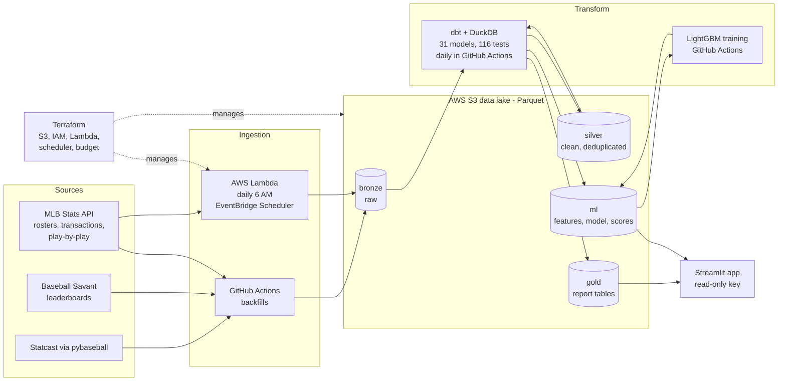

# Baseball Advance Scouting Report Generator

**Live app:** https://baseball-advance-scouting.streamlit.app (may take a moment to wake up)

## At a glance
An automated advance-scouting platform for MLB: pick an opponent, get pitcher and hitter reports that end in a
plain-language **"how to attack him"** plan, plus running-game, defense, and a model-driven pitch planner.

- **Data:** 716,792 Statcast pitches (2,429 games, full 2026 regular season), MLB Stats API rosters, transactions and
  play-by-play (14,392 running-game events), and Baseball Savant leaderboards.
- **Runs itself:** a Lambda pulls rosters and transactions every morning; GitHub Actions rebuilds and tests every table daily.
- **Tested:** 31 dbt models and 116 data tests, including leakage guards and cross-table reconciliations.
- **Model:** LightGBM whiff probability, 22% better than a constant baseline in every walk-forward test month,
  AUC 0.80, calibrated within about 1 point.
- **Infrastructure as code:** Terraform with remote state; least-privilege IAM; the public app is read-only.
- **Honest by design:** rule-based summaries show sample sizes; our own tests found clutch hitting and
  "whiffs over expected" weren't repeatable, and we report that.

## Architecture

Automated MLB advance scouting reports: Statcast + MLB Stats API -> AWS S3 data lake -> dbt -> whiff model -> Streamlit app.

## Status
- [x] Phase 1: AWS setup, one-week local test, full backfill in Actions, quality report documented
- [x] Phase 2: dbt silver/gold models + tests passing
- [x] Scouting additions (Tier 1): home/road, player directory, attack zones, command, swing decisions, bat tracking,
      spray charts, HBP, run expectancy, situational hitting
- [x] Phase 3: whiff model trained, calibration checked, trained in GitHub Actions
- [x] Phase 4: Terraform + Lambda/EventBridge daily pull + scheduled dbt, running game and defense data
- [x] Phase 5: Streamlit app live: https://baseball-advance-scouting.streamlit.app
- [ ] Phase 6: README, resume bullet, pitch, outreach

Ideas deliberately deferred, with reasons, are tracked in [BACKLOG.md](BACKLOG.md).

## Data & Quality
Full 2026 regular season (Mar 25 - Sep 27, 184 game days): 716,792 pitches, 2,429 games, 868 pitchers,
plus MLB Stats API teams, daily 40-man roster snapshots, transactions, and official profiles for all 1,470 players.
Loaded by GitHub Actions into an AWS S3 data lake (Parquet, bronze layer) under a least-privilege IAM user and a
budget alarm. The full-season backfill runs in about a minute and resumes safely after failures.

Quality findings:
- **Game count reconciled against the official MLB schedule:** 2,430 scheduled, 2,429 played, all 2,429 present.
  The one gap (BAL at NYY, Sep 27) was cancelled and never played.
- **0 duplicate pitch keys** in bronze; a dbt uniqueness test now guards against duplicate ingestion.
- **2,676 untracked pitches (0.37%): 2,309 are pitch-clock violations** (automatic balls/strikes, where no pitch
  is thrown); the other 367 are real pitches the tracking system missed. All kept and flagged, never deleted.
- **957 pitches under 50 or over 106 mph: 953 (99.6%) were thrown by position players** (56 position players,
  2,167 pitches). My first hypothesis (eephus pitches, knuckleballs) was wrong; the data ruled it out.
- **Transactions:** 1,007 duplicate rows from overlapping pulls removed, leaving 10,588 unique transactions.
- **Newer Statcast fields are well populated:** bat speed on 97.4% of swings, batted-ball location on 99.9% of
  balls in play, run value on 99.7% of pitches, arm angle on 99.6% of thrown pitches.
- **Shared names:** 2 names belong to two different players each (Max Muncy, 3B for LAD and ATH; Yunior Marte,
  P for CIN and SF). Display names add position and team; a unique test enforces it.

## Transformations (dbt on S3)
dbt Core 1.12 + dbt-duckdb reads bronze Parquet from S3 and writes silver and gold Parquet back to S3.
22 models, 88 data tests, all passing; the full build runs in under 20 seconds.

**Silver:** `silver_pitches` (716,792 deduplicated, typed pitches; matches bronze exactly) and `silver_players`.

**Shared base:** `int_pitches` defines every rule once (swing, whiff, plate appearance, wOBA contributions, chase,
hard-hit, HBP, teams and park, attack zones, pitch groups); `int_batted_balls` adds spray geometry and field zones.

**Gold (what the app reads):**
| Table | What a coach gets |
|---|---|
| `gold_players` | Player directory with guaranteed-unique display names |
| `gold_pitcher_arsenal` | Pitch mix, velocity, movement, arm angle, whiff / chase / CSW, command (heart / edge / chase / waste %) |
| `gold_pitcher_usage_by_count` | What he throws in every count, vs LHH and RHH |
| `gold_pitcher_locations` | Where each pitch goes (Statcast zones) and what happens there |
| `gold_pitcher_platoon` | Results vs LHH and RHH: K%, BB%, HBP%, wOBA, xwOBA, chase, hard-hit |
| `gold_pitcher_spray_allowed` | Where hitters put the ball against him (12 field zones), for defensive positioning |
| `gold_hitter_splits` | Each hitter vs LHP and RHP, including HBP% |
| `gold_hitter_vs_pitch_type` | Each hitter vs each pitch type |
| `gold_hitter_zones` | Where each hitter swings, misses and does damage |
| `gold_hitter_swing_decisions` | Swing/take decisions and run value by attack zone |
| `gold_hitter_bat_tracking` | Bat speed, swing length, attack angle by pitch group |
| `gold_hitter_spray` | Where each hitter hits it, by pitcher hand, pitch group and pitch speed (12 field zones) |
| `gold_hitter_situational` | Results with runners on each base, vs his own overall level |
| `gold_player_home_road` | Home vs road results (park effects, e.g. Coors Field) |
| `gold_hitter_form` / `gold_pitcher_form` | Last 30 days vs earlier in the season; fastball velocity-drop flag |
| `gold_run_expectancy` | Chance of scoring after each event, by runners on base and outs |
| `gold_transactions` | Deduplicated roster moves for the "what changed" feed |

**Design decisions:**
- **Keep and flag, never delete.** Position-player pitches and pitch-clock violations stay with flags; reports
  exclude them by default because they would mislead a coach.
- **Two wOBA conventions.** Default counts reached-on-error as an out; a Statcast-style column matches Baseball
  Savant. League 2026: .316 (errors as outs), .323 (Statcast style), xwOBA .314.
- **Attack zones** (our implementation of Savant's heart / shadow / chase / waste): bands at 67% / 133% / 200% of
  each batter's own zone.
- **12 field zones:** infield/outfield x front/back x left/center/right (cutoffs 100 / 160 / 275 ft, +/-15 degrees).
- **Counts, not percentages, at fine grain** (spray charts), so the app never shows a misleading share from a tiny cell.
- **Backtesting.** Form tables accept an `as_of_date`.

## Validation beyond tests
- **Reconciliation:** hitter and pitcher tables match exactly: 181,220 plate appearances, 711,956 located pitches,
  122,568 batted balls, and HBP rate (1.16%).
- **Physics and known players:** pitch movement matches pitch types; arm-angle extremes are known submarine and
  sidearm pitchers (Tyler Rogers, -60.6 degrees); fastest bats are known power hitters (league 71.3 mph average,
  25.2% of swings 75+ mph).
- **Spray coordinates:** fielder positions land on the correct side (3B -37 degrees, CF 0, 1B +45); home-run
  distances match Statcast within about 1%; 99% of home runs fall in the deepest outfield zones; pull rates mirror
  for left- and right-handed hitters (43-47% pulled).
- **wOBA level:** first came out 8 points high; traced to Statcast's error convention plus a numerator bug, both fixed.
- **Attack zones vs Statcast:** heart pitches are 100% inside Statcast's strike zone; chase and waste are 0%.
  Swing rate falls from 71.7% (heart) to 7.6% (waste); whiff rate on swings rises from 11.1% to 87.4%.
- **Swing decisions:** league-wide, swinging beats taking only in the heart (+0.37 vs -6.18 runs per 100 pitches);
  taking wins in chase and waste. Run-value sign verified first (HR +1.53, ball +0.05, called strike -0.05).
- **Run expectancy:** chance of scoring rises with runners and falls with outs (bases empty, 0 outs: 27.0%;
  bases loaded, 0 outs: 86.7%), and transitions are consistent (walk with runner on 1st, 0 outs: 61.4% vs the
  1st-and-2nd, 0-out state's 62.1%).
- **Park effects:** Colorado ranks #2 of 30 ballparks by league wOBA (.352), behind the Athletics' temporary park.

## Findings
- **Hot streaks are partly real:** in a backtest from Aug 28, hot hitters went from +.061 xwOBA above baseline to
  +.026 over the next 30 days; cold hitters from -.059 to -.035. Roughly half carries forward.
- **"Clutch" is not a stable skill here:** a hitter's runners-in-scoring-position edge in the first half has
  correlation 0.02 with the second half (199 hitters). Hitters do better with runners on in general (wOBA .310
  bases empty vs .323 runner on 1st), but not in a repeatable player-specific way.
- **HBP is not a patience skill:** HBP rate and walk rate are unrelated (correlation -0.09, 265 hitters), and the
  most-hit batters do not see more inside pitches. Points to the hitter's side (e.g. crowding the plate); stance
  data needed to confirm.
- **After an HBP, teams score in the rest of the inning 41.0% of the time** (vs 37.8% after a walk, 48.1% after a single).
- **Runner on first:** pitchers barely change their mix or velocity, yet hitters gain 16 wOBA points; causes not yet separated.
- **Whiff base rates** (the bar for the Phase 3 model): 10.9% of pitches, 22.9% of swings; always predicting the
  average gives log-loss of about 0.344 per pitch.

## Known limitations
- **Not park-adjusted** beyond the home/road split.
- **Command is where pitches end up, not where they were aimed** (catcher targets are not public).
- **Swing-decision run value includes contact results.**
- **No opponent-quality adjustment.**
- **Spray location is where the ball was fielded,** not always where it first landed (first-landing distance kept separately).

## Whiff model (Phase 3)
**Question:** if a hitter swings at this pitch, what is the chance he misses? (whiff per swing; base rate 22.9%)

**Data:** 339,601 swings (real pitchers, tracked pitches), built as a tested dbt model (`ml_whiff_features`).

**Features, all known before the pitch:** pitch type, velocity, spin, arm angle, movement (arm-side and vertical,
flipped so lefties and righties compare); location relative to each batter's own zone; contrast with the pitcher's
own fastball (velocity and movement differences); count and handedness; batter and pitcher whiff tendencies.

**Leakage prevention:**
- No after-the-pitch inputs (bat speed, exit velocity, launch angle, outcome, run value).
- Tendencies come from strictly earlier game dates (as-of joins); two dbt tests fail the build if any feature
  sees same-day or same-game data.
- Time-based splits only, never random.

**Results:**
| Evaluation | Log-loss | Baseline (always 22.9%) | Improvement | AUC |
|---|---|---|---|---|
| Rolling: test June | 0.419 | 0.539 | 22% | 0.80 |
| Rolling: test July | 0.421 | 0.539 | 22% | 0.80 |
| Rolling: test August | 0.413 | 0.533 | 23% | 0.80 |
| Rolling: test September | 0.418 | 0.539 | 22% | 0.80 |
| Cross-fitted, full season | 0.418 | 0.537 | 22% | — |

- **Calibrated:** on unseen September, every predicted-probability bin is within about 1.3 points of the actual
  whiff rate (e.g. predicted 29.3% -> actual 29.6%). Cross-fitted calibration error 0.003 across the season.
- **Stable across the season:** 22.0-22.7% better than the baseline in every test month.
- **What drives it:** location (about 58% of importance), then batter tendencies, count, pitch movement, and
  speed difference from the pitcher's fastball (whiff rate nearly doubles from within 2 mph to 6-10 mph slower).

**Experiments and decisions:**
- **Fatigue and recent-form features** (pitch count, times through the order, velocity so far today, days rest,
  30-day form): consistently lower log-loss but only by 0.0003. Not adopted: velocity and location already carry
  the fatigue signal, and three of these are only known during a game, while reports are pre-game.
- **Whiffs over expected** (actual minus cross-fitted expected, per pitcher and pitch type): well calibrated league-wide
  (77,815 actual vs 77,981 expected) but not repeatable (first-half vs second-half correlation 0.01), because the
  model already knows each pitcher's track record. Used as a "due to regress" flag, not a skill measure.

**Production:**
- Final model trained on the full season (tree count by early stopping on the last 14 days), saved to S3 with a
  model card: features, exact category lists, training dates and the rolling-evaluation results.
- Reusable scoring module (`src/model/score.py`) loads the model from S3 and applies the saved categories; smoke-tested.
- **GitHub Actions** retrains end to end (dbt build and tests, evaluation, final model, cross-fitted scores) in
  about 6 minutes.
- **Reproducibility:** rows sorted and seed fixed, so runs on the same machine match exactly. Windows and Linux
  differ slightly in where early stopping lands (734 vs 802 trees) with the same quality.

**Limitations:** location dominates, so this model answers "where should this pitch go?" more than "how good is the
pitch itself?"; a location-free stuff model is on the backlog. Train AUC 0.85 vs test 0.80: mild overfitting.

## Automation and infrastructure (Phase 4)
**Runs itself every day:**
- **6:00 AM Denver:** EventBridge Scheduler triggers a Lambda that pulls 40-man rosters (dated snapshot) and recent
  transactions from the MLB Stats API into S3 bronze. Python 3.13 with the official AWS SDK for pandas layer
  (pinned version, looked up via SSM); about 3 seconds per run, far inside Lambda's free allowance.
- **About an hour later:** GitHub Actions rebuilds silver and gold and runs every dbt test; GitHub emails on failure.
- **On demand:** GitHub Actions workflows for the Statcast backfill, play-by-play backfill, and model training.

**Infrastructure as code (Terraform):**
- Remote state in a dedicated, versioned, private S3 bucket with native state locking.
- Hand-made Phase 1 resources (data bucket, pipeline user, budget alarm) imported with no drift; the data bucket
  has `prevent_destroy`.
- Lambda, scheduler, IAM roles and log retention (14 days) defined in code.

**Least-privilege identities:**
| Identity | Can do | Where its keys live |
|---|---|---|
| `scouting-pipeline` | Read/write the data bucket only | `.env` (local) and GitHub Secrets |
| `scouting-app-readonly` | Read gold tables and the model only | Streamlit secrets (Phase 5) |
| Lambda role | Write `bronze/mlb/*` and its own logs only | None (AWS role) |
| Scheduler role | Invoke the one Lambda only | None (AWS role) |
| `terraform-deployer` | Deploy infrastructure | Local AWS CLI profile only, never in the repo or CI |

The read-only user was verified with real requests (reads gold; denied on bronze and on writes), because the IAM
policy simulator reported organization-level denies that don't apply on this free-plan account.

## Running game and defense
- **Play-by-play feed (MLB Stats API):** 14,392 running-game events from all 184 game dates: 9,680 pickoff throws,
  3,289 stolen bases, 1,015 caught stealing (incl. pickoff caught stealing), 222 pickoffs, 186 pickoff errors.
  99.4% join to a Statcast at-bat with the same pitcher; the rest are outs on the bases before any pitch.
- **Baseball Savant leaderboards:** sprint speed, catcher pop time, Outs Above Average (by direction and batter
  hand), outfield catch probability, outfielder jump.
- **Reports:** runner (attempt rate per opportunity, success, sprint speed), pitcher (pickoff throws per
  opportunity, steals and success against), catcher (caught-stealing rate, pop time, arm strength), fielder (OAA,
  catch probability, jump).
- **Validation:** runner, pitcher and catcher steal totals reconcile; faster runners attempt more (correlation
  +0.62) but don't succeed more (+0.06, likely selection: slow runners only go when sure); quicker catcher pop
  times mean more runners caught (-0.58); outfielder jump tracks OAA (+0.79).
- **Not available publicly:** pitcher step-offs without a throw, lead distances, steal timing.
- **40-man rosters listing up to 51 players** are explained by 60-day injured players, who appear on the list but
  don't count against the limit in season.

## Operational notes
- GitHub pauses scheduled workflows in public repos after 60 days without commits; re-enable with one click.
- The AWS free plan ends Apr 29, 2027; the app reads data behind a `DATA_BACKEND` setting so it can switch to
  MotherDuck if the account isn't upgraded. See [BACKLOG.md](BACKLOG.md).

## The app (Phase 5)
**Live:** https://baseball-advance-scouting.streamlit.app · Streamlit Community Cloud · reads gold tables and the
model from S3 with a read-only key (behind a `DATA_BACKEND` setting, so it can switch to MotherDuck later).

| Page | What a coach gets |
|---|---|
| Home | Pick the opponent; its pitchers and hitters with **current roster status** (daily snapshot: active, IL, left in free agency); "What changed" roster moves |
| Pitcher report | **How to attack him** summary; arsenal with command and movement; movement chart; usage by count; location heatmap; platoon; form and velocity flag; home/road; spray allowed (12 field zones) for positioning |
| Hitter report | **How to attack him** summary; splits; results vs each pitch type; zone map; swing decisions; bat tracking; spray chart by pitcher hand, pitch group and speed; runners on base (with clutch caveat); form; home/road |
| Running game & defense | Runners (attempt rate, sprint speed), pitchers' hold (pickoff throws per opportunity), catchers (pop time chart), fielders (OAA by direction, outfielder jump) |
| Pitch planner | The whiff model scores one of our pitches against their hitter across 121 locations; "whiff if he swings" and "whiff per pitch" views |
| Methods & data | Freshness, sources, definitions, every summary threshold, validations, limitations |

**Honesty features:** rule-based summaries (deterministic, every claim shows its sample size); small samples
flagged; thin heatmap cells hidden; a global toggle for counting reached-on-error as hits (Statcast convention).

